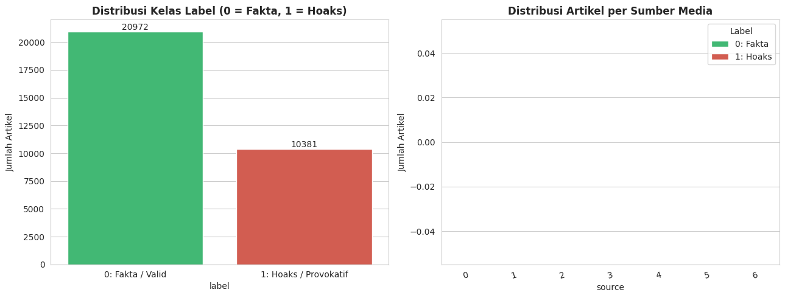
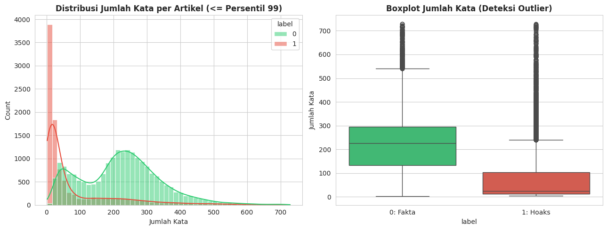
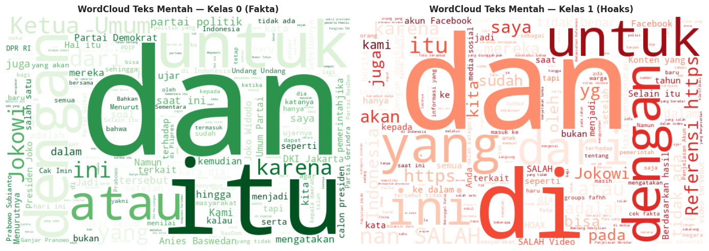

## INFORMASI PROYEK

**Judul Proyek:**  
Klasifikasi Teks Berita Provokatif (*Clickbait*) dan Disinformasi Politik Viral di Indonesia Menggunakan Pendekatan *Machine Learning* dan *Deep Learning*

**Nama Mahasiswa:**  
1. Dava Febri Wardana  
2. Kunni Sofa Rahmayani  

**NIM:**  
1. 244311039  
2. 244311046  

**Program Studi:** D4 Teknologi Rekayasa Perangkat Lunak  
**Mata Kuliah:** Data Science / Machine Learning  
**Dosen Pengampu:** Gus Nanang Syaifuddiin, S.Kom., M.Kom.    
**Tahun Akademik:** 2026/2027 (Semester 5)  
**Link GitHub Repository:** https://github.com/davafw/id-political-disinformation-ml.git  
**Link Video Pembahasan:** [Menunggu Tahap Evaluasi Minggu 6]  
**SDG yang Dipilih:** SDG 16 – Perdamaian, Keadilan, dan Kelembagaan yang Tangguh  
**Target SDG yang Relevan:** Target 16.10 – Menjamin akses publik terhadap informasi dan melindungi kebebasan mendasar, sesuai dengan peraturan nasional dan kesepakatan internasional

---

## 0. KERANGKA ML LIFECYCLE (L-M-O-P)

Laporan ini disusun mengikuti **ML Lifecycle** yang terdiri dari empat tahap berulang (iteratif):

| Tahap | Singkatan | Inti Pertanyaan | Bagian Laporan |
|-------|-----------|-----------------|----------------|
| **Learning Problem** | **L** | Apa target, objective, dan datanya? | Bab 2, 3, 4, 5 |
| **Model Design** | **M** | Model family/arsitektur apa, hypothesis space, dan inductive bias/asumsi apa? | Bab 6 (6.x.1 – 6.x.3) |
| **Optimization** | **O** | Bagaimana model dilatih: loss, optimizer, tuning, regularisasi, konvergensi? | Bab 6 (6.x.4 – 6.x.6) |
| **Predict & Evaluate** | **P** | Seberapa baik prediksi model berdasarkan metrik evaluasi? | Bab 7 |

```
   L (Learning Problem) ──► M (Model Design) ──► O (Optimization) ──► P (Predict & Evaluate)
          ▲                                                                   │
          └─────────────── iterasi / perbaikan berdasarkan hasil evaluasi ────┘
```

**Catatan untuk mahasiswa:** Setiap bagian diberi label **[L]**, **[M]**, **[O]**, atau **[P]**. Pastikan Anda dapat menjelaskan keterkaitan antar tahap, misalnya bagaimana hasil **P** mendorong perbaikan pada **L/M/O** (Bab 7.5).

---

## 1. LEARNING OUTCOMES
Pada proyek ini, mahasiswa diharapkan dapat:
1. **[L]** Mengidentifikasi masalah nyata dari **ide sendiri** yang selaras dengan salah satu tujuan **SDGs** ([Agenda 2030 – sdgs.un.org/2030agenda](https://sdgs.un.org/2030agenda)), lalu merumuskan problem statement (target, objective, data) secara jelas
2. **[L]** Melakukan analisis dan eksplorasi data (EDA) secara komprehensif (**OPSIONAL**)
3. **[L]** Melakukan data preparation yang sesuai dengan karakteristik dataset
4. **[M]** Merancang tiga model machine learning dengan justifikasi hypothesis space dan inductive bias (**WAJIB**):
   - Model baseline
   - Model machine learning / advanced
   - Model deep learning (**WAJIB**)
5. **[O]** Mengoptimasi model secara sistematis (loss function, optimizer, hyperparameter tuning, regularisasi)
6. **[P]** Menggunakan metrik evaluasi yang relevan dengan jenis tugas ML dan menganalisis hasilnya
7. Melaporkan hasil eksperimen secara ilmiah dan sistematis
8. Mengunggah seluruh kode proyek ke GitHub (**WAJIB**)
9. Menerapkan prinsip software engineering dalam pengembangan proyek

---

## 2. PROJECT OVERVIEW  **[L]**

### 2.1 Latar Belakang
Perkembangan media online dan media sosial membuat informasi politik menyebar sangat cepat di Indonesia. Di sisi lain, isu politik yang viral dan berlarut-larut, seperti polemik keaslian ijazah tokoh publik atau perdebatan antar-tokoh di ruang publik, sering dimanfaatkan akun atau situs tidak bertanggung jawab. Mereka membuat judul dan narasi yang provokatif (*clickbait*) atau menyesatkan demi memancing emosi dan interaksi warganet. Akibatnya, pembaca kesulitan membedakan berita jurnalistik yang informatif dari teks yang bersifat provokatif atau disinformasi, sementara pemeriksaan manual tidak mampu mengimbangi volume dan kecepatan penyebarannya.

Pada domain *Natural Language Processing* (NLP), permasalahan ini dapat dirumuskan sebagai klasifikasi teks, yaitu mengenali pola bahasa yang membedakan kedua jenis teks tersebut. Tantangannya antara lain bahasa Indonesia yang informal, label yang rawan subjektif karena kebenaran pada konflik politik sulit diverifikasi secara mutlak, dan risiko model menghafal nama tokoh alih-alih pola kalimat provokatif. Penelitian NLP berbahasa Indonesia sudah berkembang, misalnya klasifikasi emosi pada data Twitter Indonesia (Saputri et al., 2018) dan penyediaan benchmark serta sumber daya pemahaman bahasa Indonesia melalui IndoNLU (Wilie et al., 2020). Keduanya menunjukkan bahwa teks berbahasa Indonesia dapat dimodelkan dengan pendekatan *machine learning* dan *deep learning*.

Proyek ini membandingkan tiga pendekatan (Logistic Regression, Decision Tree/Random Forest, dan jaringan saraf sederhana dengan *learned embeddings*) untuk mengklasifikasikan teks provokatif dan disinformasi politik. Hasilnya diharapkan bermanfaat sebagai alat bantu penyaringan awal bagi pembaca, pemeriksa fakta, atau moderator konten, serta sebagai bahan studi perbandingan model untuk penelitian selanjutnya. Proyek ini berkaitan dengan SDG 16 Target 16.10 karena membantu publik mengakses informasi yang andal (dijabarkan di Bab 2.2).

**Referensi:**
- Saputri, M. S., Mahendra, R., & Adriani, M. (2018). Emotion classification on Indonesian Twitter dataset. *Proceedings of the 2018 International Conference on Asian Language Processing (IALP)*, 90–95.
- Wilie, B., et al. (2020). IndoNLU: Benchmark and resources for evaluating Indonesian natural language understanding. *Proceedings of the 1st Conference of the Asia-Pacific Chapter of the Association for Computational Linguistics and the 10th International Joint Conference on Natural Language Processing (AACL-IJCNLP)*, 843–857.

### 2.2 Keterkaitan dengan SDGs (WAJIB)

Ide proyek **berasal dari mahasiswa** dan harus selaras dengan **salah satu** dari 17 Sustainable Development Goals (daftar dan contoh inspirasi ada di Lampiran A).

| Komponen | Pertanyaan Panduan | Jawaban Anda |
|----------|--------------------|--------------|
| **SDG yang dipilih** | Goal nomor berapa dan apa namanya? | SDG 16 – Perdamaian, Keadilan, dan Kelembagaan yang Tangguh |
| **Target SDG** | Target (misal 3.4, 13.1) mana yang paling relevan? | Target 16.10 – Menjamin akses publik terhadap informasi dan melindungi kebebasan mendasar, sesuai dengan peraturan nasional dan kesepakatan internasional |
| **Masalah nyata** | Masalah konkret apa yang diangkat? Siapa yang terdampak? | Isu politik viral yang berlarut-larut (misalnya polemik keaslian ijazah tokoh publik dan perdebatan antar-tokoh) sering dimanfaatkan akun atau situs tidak bertanggung jawab untuk membuat judul dan narasi manipulatif demi memancing emosi warganet. Yang terdampak adalah masyarakat pembaca berita online, yang sulit membedakan informasi akurat dari narasi provokatif, serta institusi dan tokoh publik yang menjadi sasaran disinformasi. |
| **Peran ML** | Mengapa ML/DL cocok? Apa keputusan atau proses yang dibantu? | Volume berita dan unggahan viral terlalu besar untuk diperiksa manual. Klasifikasi teks biner (0 = berita jurnalistik informatif, 1 = provokatif/disinformasi) dapat menyaring teks secara otomatis berdasarkan pola bahasanya. Model membantu proses penyaringan awal sebelum verifikasi oleh manusia (pemeriksa fakta atau moderator). |
| **Indikator kontribusi** | Bagaimana hasil model berkontribusi pada target SDG (langsung/tidak langsung)? | Kontribusi tidak langsung: model menandai teks yang berpotensi menyesatkan sehingga publik lebih mudah mengakses informasi yang andal (Target 16.10). Indikatornya adalah kemampuan model mendeteksi teks provokatif, diukur dengan accuracy, precision, dan recall pada data uji. Proyek ini berupa prototipe penelitian, belum sistem yang dipakai langsung oleh publik. |
| **Pertimbangan etika** | Risiko bias, privasi, atau dampak salah prediksi? |(1) Label noise: pelabelan berita politik rawan bias manusia atau institusi karena kebenaran mutlak sulit diverifikasi. (2) Overfitting nama tokoh: model berisiko menghafal nama tokoh sebagai penanda hoaks, sehingga perlu regularisasi dan pemilihan fitur yang berfokus pada pola kalimat provokatif. (3) Salah prediksi: false positive dapat membungkam berita sah (bertentangan dengan kebebasan informasi), sedangkan false negative meloloskan disinformasi. Karena itu keluaran model dipakai sebagai alat bantu, bukan penentu akhir. (4) Privasi: hanya memakai dataset publik tanpa data pribadi pengguna. |

**Sumber ide:** Ide berasal dari isu nasional, yaitu maraknya polemik politik viral di Indonesia yang berlarut-larut, seperti perdebatan keaslian ijazah tokoh publik dan adu argumen antar-tokoh di ruang publik. Isu semacam ini sering dimanfaatkan akun atau situs tidak bertanggung jawab untuk membuat judul dan narasi provokatif demi memancing emosi dan interaksi warganet. Dari pengamatan terhadap fenomena tersebut, kami tertarik membangun model yang dapat mengenali pola bahasa provokatif secara otomatis.

### 2.3 Ringkasan Alur Lifecycle Proyek

Pada tahap **L**, kami merumuskan masalah sebagai klasifikasi biner teks (`0` = berita jurnalistik informatif dari CNN Indonesia, Kompas, dan Tempo; `1` = teks provokatif/disinformasi dari TurnBackHoax) menggunakan dataset berlabel dari Kaggle, lalu membersihkan teks dan membagi data menjadi *train* (60%), *validation* (20%), dan *test* (20%) tanpa kebocoran informasi (*data leakage*). Pada tahap **M**, kami merancang tiga model bertahap: *Logistic Regression* dengan *Bag-of-Words*/TF-IDF sebagai *baseline*, *Support Vector Machine (SVM)* sebagai model *advanced*, dan *Neural Network* sederhana (*Embedding + 2 Dense Hidden Layers*) sebagai model *deep learning*. Pada tahap **O**, model dilatih dengan fungsi kerugian *binary cross-entropy*, penyetelan *hyperparameter*, serta kontrol *overfitting* menggunakan regularisasi dan *early stopping*. Pada tahap **P**, ketiga model dievaluasi satu kali pada *test set* menggunakan *accuracy, precision, recall,* dan *F1-score*, dengan rencana iterasi kembali ke tahap **L** dan **O** jika ditemukan ketergantungan berlebih pada kata kunci tertentu.

---

## 3. BUSINESS UNDERSTANDING / PROBLEM UNDERSTANDING  **[L]**

### 3.1 Problem Statements
Tuliskan 2–4 pernyataan masalah yang jelas dan spesifik.

**Contoh (universal):**
1. Model perlu mampu memprediksi nilai target dengan akurasi tinggi
2. Sistem harus dapat mengidentifikasi pola pada citra secara otomatis
3. Dataset memiliki noise sehingga perlu preprocessing yang tepat
4. Dibutuhkan model deep learning yang mampu belajar representasi fitur kompleks

1. Volume berita dan unggahan terkait isu politik viral di Indonesia sangat besar dan menyebar cepat, sehingga diperlukan model klasifikasi teks biner otomatis yang mampu membedakan antara berita jurnalistik informatif (`0`) dan teks provokatif/disinformasi (`1`) dengan akurasi, *precision*, serta *recall* yang tinggi[cite: 14, 15, 49].
2. Teks berita politik mengandung *noise* bahasa informal serta risiko *keyword overfitting* (model menghafal nama tokoh atau institusi tertentu sebagai penanda hoaks), sehingga diperlukan proses *text preprocessing*, penyamaran entitas nama tokoh (*entity masking*), dan pembagian data yang bebas dari *data leakage*[cite: 17, 26, 32, 49].
3. Representasi fitur sederhana seperti *Bag-of-Words* mengabaikan urutan dan konteks kata dalam kalimat, sehingga diperlukan perbandingan sistematis antara model *baseline* linear, model *advanced* berbasis pohon keputusan (*Decision Tree/Random Forest*), dan model *deep learning* dengan *learned embeddings* untuk menemukan arsitektur dengan generalisasi terbaik[cite: 18, 29, 30, 45, 49].

### 3.2 Formulasi Learning Problem (WAJIB)

Rumuskan masalah dalam kerangka *Learning Problem*:

| Komponen | Pertanyaan Panduan | Jawaban Anda |
|----------|--------------------|--------------|
| **Target** | Apa yang diprediksi? Jenis tugas (klasifikasi biner/multikelas, regresi, forecasting, clustering, dll.)? | [Supervised Learning – **Klasifikasi Biner**[cite: 12, 14]. Memprediksi label kategori diskret $Y \in \{0, 1\}$ pada teks berita/unggahan politik, di mana `0` = berita jurnalistik informatif dan `1` = teks provokatif (*clickbait*) / disinformasi[cite: 9, 14].] |
| **Objective** | Apa yang dioptimalkan/diminimalkan secara matematis (misal: cross-entropy, MSE)? Metrik keberhasilan utama? | [Saat Pelatihan (Loss Function): Meminimalkan *Binary Cross-Entropy Loss* untuk mengukur kesalahan prediksi probabilitas model pada setiap sampel[cite: 14, 15].<br>**Saat Penilaian (Metrik Evaluasi):** *Accuracy*, *Precision*, *Recall*, dan *F1-Score* pada *test set* untuk memastikan model tidak hanya akurat secara keseluruhan, tetapi juga seimbang dalam menekan *false positive* (berita sah yang salah dilabeli provokatif) dan *false negative* (disinformasi yang lolos)[cite: 14, 15, 49].] |
| **Data** | Sumber, ukuran, jenis, dan asumsi tentang data (i.i.d.? distribusi train vs test?) | [*Sumber:** Kaggle (*Indonesian Fact and Hoax Political News Dataset* / *TurnBackHoax & Clickbait Dataset*) yang berjumlah $\pm 5.000 - 15.000$ baris teks berbahasa Indonesia[cite: 1, 16, 49].<br>**Jenis Data:** Data Teks (*Text*)[cite: 1, 29, 49].<br>**Asumsi Data:** Data diasumsikan *independent and identically distributed* (i.i.d.) antara *training set* (~60%), *validation set* (~20%), dan *test set* (~20%) melalui pengacakan berstratifikasi (*stratified split*, `random_state=42`)[cite: 18, 20, 21, 49]. Seluruh transformasi fitur (`fit_transform`) hanya dipelajari dari *training set* untuk mencegah *data leakage*.] |

### 3.3 Goals

Tujuan harus spesifik, terukur, dan selaras dengan problem statement.
**Contoh tujuan:**
1. Membangun model ML untuk memprediksi variabel target dengan akurasi > 80%
2. Mengukur performa tiga pendekatan model (baseline, advanced, deep learning)
3. Menentukan model terbaik berdasarkan metrik evaluasi yang relevan
4. Menghasilkan sistem yang dapat bekerja secara reproducible

> Sertakan minimal satu goal yang menunjukkan kontribusi terhadap target SDG yang dipilih (Bab 2.2).

1. Menghasilkan *pipeline* pengolahan data teks berbahasa Indonesia yang bersih, bebas *data leakage*, dan dilengkapi mekanisme penyamaran kata kunci nama tokoh untuk meminimalkan bias *overfitting*[cite: 17, 26, 32, 49].
2. Membangun, melatih, dan mengukur performa tiga pendekatan model (*Baseline Logistic Regression*, *Advanced Random Forest*, dan *Deep Learning Embedding + Dense/LSTM*) dengan target capaian *Accuracy* dan *F1-Score* $> 80\%$ pada *test set*[cite: 45, 49].
3. Menentukan model terbaik berdasarkan analisis perbandingan metrik evaluasi (*Accuracy*, *Precision*, *Recall*, *F1-Score*), waktu komputasi pelatihan, dan ketahanan terhadap *overfitting* pada data baru[cite: 15, 18, 41, 49].
4. Menghasilkan prototipe penyaringan awal (*early screening*) teks provokatif/disinformasi yang *reproducible* di GitHub untuk mendukung **SDG 16 Target 16.10** dalam membantu publik mengakses informasi yang andal tanpa melanggar kebebasan informasi[cite: 1, 49].

### 3.4 Solution Approach  **[M]**

#### **Model 1 – Baseline Model**
- **Model yang Dipilih:** **Logistic Regression** dengan representasi fitur *Bag-of-Words* / TF-IDF.
- **Alasan Pemilihan:** *Logistic Regression* merupakan model linear parametrik yang cepat dilatih, hemat data, dan mudah ditafsirkan melalui bobot koefisien tiap kata. Model ini berfungsi sebagai tolok ukur (*baseline*) yang jujur sebelum kompleksitas dinaikkan.

#### **Model 2 – Advanced / ML Model**
- **Model yang Dipilih:** **Support Vector Machine (SVM)**.
- **Alasan Pemilihan:** Berbeda dengan *Logistic Regression*, SVM mencari bidang pembatas keputusan (*decision boundary*) dengan jarak (*margin*) paling optimal di antara kelas teks valid (`0`) dan hoaks (`1`). SVM sangat tangguh untuk fitur teks berdimensi tinggi dan mampu membentuk batas keputusan non-linear melalui penggunaan *kernel*.

#### **Model 3 – Deep Learning Model**
- **Model yang Dipilih:** **Kategori C (Text Data) – Neural Network Sederhana (`Embedding + GlobalAveragePooling1D + 2 Dense Hidden Layers + Dropout`)**.
- **Alasan Pemilihan:** Menggunakan konsep dasar *Neural Network* yang dipelajari di perkuliahan, arsitektur ini menggabungkan lapisan *Embedding* (*learned vector embeddings*) dengan dua *hidden layers* (`Dense` beraktivasi ReLU) dan regularisasi `Dropout` untuk mencegah *overfitting*. Model dilatih minimal 10 *epochs* lengkap dengan pencatatan waktu *training*, kurva *loss* dan *accuracy* per *epoch*, serta evaluasi akhir pada *test set*.
---

## 4. DATA UNDERSTANDING  **[L]**

### 4.1 Informasi Dataset
**Sumber Dataset:**  
Kaggle — *Indonesian Fact and Hoax Political News* (`https://www.kaggle.com/datasets/linkgish/indonesian-fact-and-hoax-political-news`), menggunakan 4 file pada direktori versi *Cleaned*:
- `dataset_cnn_10k_cleaned.xlsx` (9.630 baris, 9 kolom — 9,02 MB)
- `dataset_kompas_4k_cleaned.xlsx` (4.750 baris, 9 kolom — 4,35 MB)
- `dataset_tempo_6k_cleaned.xlsx` (6.592 baris, 9 kolom — 6,30 MB)
- `dataset_turnbackhoax_10_cleaned.xlsx` (10.381 baris, 11 kolom — 12,34 MB)

**Deskripsi Dataset:**
- **Jumlah baris (rows):** 31.353 artikel berita politik
- **Jumlah kolom (columns/features):** 6 kolom hasil standarisasi (`source`, `title`, `body`, `label`, `raw_text`, `word_count`)
- **Tipe data:** Data Teks (*Text*) dengan label klasifikasi biner
- **Ukuran dataset:** 32,01 MB (total gabungan 4 file Excel)
- **Format file:** Excel (`.xlsx`) yang digabung menjadi `.csv`

### 4.2 Deskripsi Fitur

| Nama Fitur | Tipe Data | Deskripsi | Contoh Nilai |
|------------|-----------|-----------|--------------|
| `source` | String / Categorical | Nama portal media sumber artikel | `"cnn_10k"`, `"kompas_4k"`, `"tempo_6k"`, `"turnbackhoax_10"` |
| `title` | String (Text) | Judul artikel berita atau klaim viral | `"Anies di Milad BKMT: Pengajian Menghasilkan..."` |
| `body` | String (Text) | Isi narasi utama berita yang diambil dari kolom `text_new` / `Clean Narasi` | `"Komisi Pemilihan Umum menyatakan..."` |
| `raw_text` | String (Text) | Gabungan fitur `title` dan `body` sebelum pembersihan | `"Anies di Milad BKMT: Pengajian..."` |
| `word_count` | Integer | Jumlah kata per artikel pada teks mentah (untuk deteksi outlier) | `271`, `292`, `195` |
| `label` | Integer (Binary Target) | Variabel target (*ground truth*): `0` = Fakta/Berita Jurnalistik Valid (CNN, Kompas, Tempo), `1` = Hoaks/Disinformasi Provokatif (TurnBackHoax) | `0`, `1` |

### 4.3 Kondisi Data
Berdasarkan hasil pemeriksaan awal (*data inspection*) pada `notebooks/01_learning_problem_eda.ipynb` dan `notebooks/02_data_preparation.ipynb`:
- **Missing Values:** Ditemukan sebanyak 21 baris kosong/bernilai `NaN` (0,07% dari total 31.353 baris) pada kolom teks/judul.
- **Duplicate Data:** Ditemukan sebanyak 14 baris artikel (0,04%) dengan isi teks mentah yang identik persis, serta tambahan duplikat setelah normalisasi teks.
- **Outliers:** Terdapat 409 baris artikel (1,30%) yang terlalu pendek ($< 5$ kata setelah pembersihan) atau terdeteksi duplikat pasca-cleaning, serta sejumlah artikel yang sangat panjang ($> 1.000$ kata) pada distribusi `word_count`.
- **Imbalanced Data:** Distribusi kelas pada data mentah bersifat tidak seimbang (*imbalanced*), dengan proporsi kelas `0` (Fakta) sebanyak 20.972 baris (66,89%) dan kelas `1` (Hoaks) sebanyak 10.381 baris (33,11%), atau sekitar rasio 2:1.
- **Noise:** Teks masih mengandung URL, tag HTML, angka, tanda baca berlebih, format tag kurung siku (`[SALAH]`, `[PENJELASAN]`), serta kata penanda sumber media seperti `"CNN Indonesia"`, `"Kompas.com"`, dan `"Tempo.co"`.
- **Data Quality Issues:** Adanya potensi *shortcut learning* jika tag nama media tidak dihapus (model hanya menghafal nama portal berita, bukan gaya bahasanya) serta potensi bias *overfitting* terhadap nama tokoh politik populer (seperti Anies, Prabowo, Jokowi, Ganjar, Roy Suryo).
- **Asumsi Data (i.i.d., distribusi train-test, potensi data leakage):** Dataset diasumsikan *independent and identically distributed* (i.i.d.) setelah diacak secara berstratifikasi (*stratified split*). Potensi *data leakage* terbesar muncul bila `TfidfVectorizer` atau `Tokenizer` di-*fit* pada keseluruhan dataset sebelum pemisahan; hal ini dimitigasi ketat dengan melakukan `fit_transform` **hanya pada *training set***.

### 4.4 Exploratory Data Analysis (EDA)

#### Visualisasi 1: Distribusi Kelas Target dan Sumber Media


**Insight:**  
Jumlah artikel kelas `0` (Fakta) secara signifikan lebih besar dibandingkan kelas `1` (Hoaks) karena kelas `0` merupakan gabungan dari tiga portal berita nasional (CNN Indonesia, Kompas, Tempo), sedangkan kelas `1` berasal dari TurnBackHoax. Kondisi *imbalanced* ini mengonfirmasi bahwa evaluasi model tidak boleh hanya mengandalkan *Accuracy*, melainkan wajib memakai *Precision*, *Recall*, dan *F1-Score*, serta memerlukan penanganan bobot kelas (*class weights*) pada data latih.

#### Visualisasi 2: Distribusi Jumlah Kata dan Deteksi Outlier


**Insight:**  
Distribusi panjang kata cenderung miring ke kanan (*right-skewed*), di mana rentang Median–Q3 keseluruhan dataset berada pada **184–276 kata** (dengan nilai minimum 2 kata dan maksimum 4.178 kata). Jika dibandingkan per kelas, artikel berita valid (`0`) memiliki panjang yang jauh lebih stabil dan terstruktur dengan median **227 kata** (Q1–Q3: 134–298 kata), sedangkan teks hoaks/provokatif (`1`) jauh lebih singkat dengan median hanya **26 kata** (Q1–Q3: 12–116 kata) karena didominasi narasi klaim pendek yang viral. Selain itu, ditemukan *outlier* ekstrem berupa teks yang terlalu pendek ($< 5$ kata, minimum 2 kata) sehingga layak dihapus pada tahap *Data Cleaning*, sementara panjang mayoritas teks setelah penghapusan *stopwords* menjadi dasar penetapan panjang *padding* (`maxlen=150`) untuk model *Neural Network*.

#### Visualisasi 3: WordCloud Teks Mentah Kelas Fakta vs Hoaks


**Insight:**  
Pada teks mentah sebelum dibersihkan, kata-kata seperti nama media/kota (`jakarta`, `cnn`, `kompas`, `tempo`) dan format periksa fakta (`salah`, `penjelasan`, `narasi`) serta nama tokoh politik mendominasi tampilan *WordCloud*. Temuan ini sangat penting: jika dibiarkan, model akan mengalami *overfitting* dengan menghafal nama portal atau nama tokoh, bukan pola kalimat provokatifnya. Oleh sebab itu, kata-kata penanda media wajib dibuang dan nama tokoh disamarkan pada tahap *Data Preparation*.

---

## 5. DATA PREPARATION  **[L]**

### 5.1 Data Cleaning
Langkah pembersihan data yang telah dijalankan pada `notebooks/02_data_preparation.ipynb`:
1. **Penghapusan *Missing Values*:** Membuang 21 baris yang memiliki teks/label kosong sehingga tersisa 31.332 baris.
2. **Penghapusan Duplikat:** Menghapus 14 artikel duplikat persis sebelum *splitting* (tersisa 31.318 baris) agar artikel yang sama tidak muncul sekaligus di *train set* dan *test set* (mencegah *data leakage*).
3. **Penghapusan *Noise* & Tag Identitas Media:** Menghapus URL, tag HTML, angka, tanda baca, tag kurung siku (`[SALAH]`, `[HOAKS]`), serta kata penanda portal berita (`cnn indonesia`, `kompas`, `tempo`, `turnbackhoax`, `mafindo`, `jakarta`, `baca juga`).
4. **Penanganan *Outlier* Teks Pendek & Duplikat Pasca-Cleaning:** Menghapus 409 baris yang menyisakan $< 5$ kata setelah pembersihan atau terdeteksi duplikat setelah normalisasi, sehingga menyisakan **30.909 baris data bersih** (Kelas `0`: 20.949 baris / 67,78%; Kelas `1`: 9.960 baris / 32,22%).

### 5.2 Feature Engineering
1. **Penggabungan Judul dan Narasi (`raw_text`):** Menggabungkan kolom `title` dan `body` karena pola *clickbait*/provokatif paling kuat muncul di judul, sementara konteks kalimat berada di isi berita.
2. **Penyamaran Entitas Tokoh Politik (*Entity Masking*):** Menyamarkan nama-nama tokoh dan partai/instansi politik yang sering muncul (seperti `jokowi`, `prabowo`, `anies`, `ganjar`, `gibran`, `megawati`, `roy suryo`, `mahfud`, `ugm`, `pdip`, `gerindra`, `golkar`, `nasdem`) menjadi token netral `tokohpublik` (terbukti pada output cleaning: `"Anies di Milad BKMT..."` menjadi `"tokohpublik milad bkmt..."`). Tujuannya memaksa model mempelajari **pola struktur kalimat provokatif**, bukan menghafal nama tokoh tertentu (mitigasi risiko etika Bab 2.2).
3. **Ekstraksi Fitur N-Gram (Unigram & Bigram):** Pada TF-IDF digunakan `ngram_range=(1, 2)` untuk menangkap frasa dua kata yang bermakna.

### 5.3 Data Transformation
Karena data bertipe teks, dilakukan transformasi menjadi representasi vektor angka sesuai kebutuhan masing-masing keluarga model:
1. **Normalisasi Teks:** *Lowercasing* (menyeragamkan huruf kecil) dan penghapusan *stop words* Bahasa Indonesia serta kata dengan panjang $\le 2$ huruf menggunakan daftar *stopwords* NLTK Bahasa Indonesia.
2. **TF-IDF Vectorization (Untuk Model 1 Logistic Regression & Model 2 SVM):** Mengubah teks menjadi matriks bobot frekuensi kata berdimensi `10.000` fitur (`max_features=10000`, `ngram_range=(1, 2)`, `min_df=3`). **`fit_transform` hanya dijalankan pada `X_train`**, menghasilkan matriks `(18545, 10000)`, sementara `X_val` `(6182, 10000)` dan `X_test` `(6182, 10000)` hanya dikenakan `transform`.
3. **Tokenization & Sequence Padding (Untuk Model 3 Neural Network):** Mengubah teks menjadi barisan indeks bilangan bulat (`VOCAB_SIZE = 10000`, `oov_token="<OOV>"`) dan menyamakan panjang seluruh input menjadi `MAX_LEN = 150` token dengan *post-padding* (`(18545, 150)` untuk train, `(6182, 150)` untuk val dan test). **`fit_on_texts` hanya dijalankan pada `X_train`**.

### 5.4 Data Splitting
Data diacak dan dibagi menggunakan **Stratified Split** (`random_state=42`) untuk menjaga rasio kelas Fakta (`0`) dan Hoaks (`1`) tetap identik pada setiap bagian:

```text
- Training set   : 60% (18.545 samples — Fakta: 12.569, Hoaks: 5.976 | Rasio Hoaks: 32,22%)
- Validation set : 20% ( 6.182 samples — Fakta:  4.190, Hoaks: 1.992 | Rasio Hoaks: 32,22%)
- Test set       : 20% ( 6.182 samples — Fakta:  4.190, Hoaks: 1.992 | Rasio Hoaks: 32,22%)
```

* **Alasan:** Pembagian 60/20/20 memisahkan peran data latih (mencari parameter), data validasi (menyetel *hyperparameter* dan mendiagnosis *overfitting* pada Minggu 3–5), dan data uji (*test set* yang disimpan terpisah di `data/processed/` dan **hanya dipakai satu kali** pada evaluasi akhir Minggu 6).

### 5.5 Data Balancing
Karena distribusi kelas pada data latih bersifat tidak seimbang (rasio Fakta : Hoaks $= 67,78\% : 32,22\%$ atau $\approx 2,1 : 1$), diterapkan teknik **Class Weights (`balanced`)** yang dihitung **hanya dari distribusi label data latih (`y_train`)** menggunakan `compute_class_weight`:
- Bobot Kelas `0` (Fakta): `0.7377`
- Bobot Kelas `1` (Hoaks): `1.5516`

**Alasan:** Penggunaan *class weights* pada tahap pelatihan (tanpa mengubah distribusi *validation set* maupun *test set*) memberikan penalti kerugian (*loss*) yang lebih besar jika model salah memprediksi kelas minoritas (Hoaks), tanpa harus membuang data berita fakta yang berharga (*undersampling*) maupun menciptakan duplikasi teks buatan (*oversampling*).

### 5.6 Ringkasan Data Preparation (Apa – Mengapa – Bagaimana)

| Tahap | Apa yang Dilakukan | Mengapa Penting | Bagaimana Implementasinya |
| :--- | :--- | :--- | :--- |
| **1. Data Cleaning** | Menghapus 21 *missing values*, 14 duplikat awal, URL, angka, tanda baca, tag media (`CNN`, `Kompas`, `Tempo`, `[SALAH]`), serta 409 teks $< 5$ kata/duplikat pasca-cleaning. | Mencegah *shortcut learning* (model menghafal nama portal berita) dan mencegah duplikasi teks bocor ke *test set*. | `dropna()`, `drop_duplicates()`, dan fungsi `re.sub()` berbasis *regular expression* di Python. |
| **2. Entity Masking** | Menyamarkan nama tokoh dan instansi politik populer menjadi token `tokohpublik`. | Mencegah *keyword overfitting* terhadap figur politik tertentu sesuai prinsip etika (Bab 2.2). | Substitusi pola *regex* pada daftar entitas politik sebelum tokenisasi. |
| **3. Stopword Removal** | Membuang kata hubung/umum Bahasa Indonesia dan kata $\le 2$ karakter. | Memperkecil ukuran kosakata dan membuang derau kata yang muncul merata di kedua kelas. | Filtrasi token menggunakan `nltk.corpus.stopwords.words('indonesian')`. |
| **4. Stratified Splitting** | Membagi 30.909 dataset bersih menjadi 60% Train (18.545), 20% Val (6.182), dan 20% Test (6.182) dengan `random_state=42`. | Mengukur kemampuan generalisasi secara jujur dengan proporsi kelas seragam (32,22% hoaks) dan hasil yang *reproducible*. | Dua kali pemanggilan `train_test_split(..., stratify=y, random_state=42)`. |
| **5. Feature Transformation** | Mengubah teks menjadi vektor TF-IDF berdimensi 10.000 (Model 1 & 2) dan *padded sequences* panjang 150 (Model 3). | Model ML/DL hanya memproses angka; memisahkan `fit` dan `transform` mencegah *data leakage*. | `TfidfVectorizer.fit_transform(X_train)` + `.transform(X_val/X_test)`; `Tokenizer.fit_on_texts(X_train)` + `pad_sequences(maxlen=150)`. |
| **6. Data Balancing** | Menghitung bobot penalti kelas (`0: 0.7377`, `1: 1.5516`) khusus dari `y_train`. | Mengatasi ketimpangan kelas (~2,1:1) agar *Recall* kelas Hoaks tidak rendah, tanpa mencemari distribusi *val/test*. | `compute_class_weight('balanced', y=y_train)` disimpan ke `class_weights.json`. |
---

## 6. MODELING  **[M + O]**

> Setiap model (6.1, 6.2, 6.3) dijelaskan dalam dua fase: **Model Design [M]** (sub-bagian .1–.3) dan **Optimization [O]** (sub-bagian .4–.6).

### 6.1 Model 1 — Baseline Model

#### 6.1.1 Deskripsi Model  **[M]**

**Nama Model:** [Nama model, misal: Logistic Regression]  
**Teori Singkat:**  
[Jelaskan secara singkat bagaimana model ini bekerja]  
**Alasan Pemilihan:**  
[Mengapa memilih model ini sebagai baseline?]

#### 6.1.2 Hypothesis Space & Inductive Bias  **[M]**

- **Model family / arsitektur:** [misal: model linear]
- **Hypothesis space:** [himpunan fungsi yang dapat direpresentasikan, misal: batas keputusan linear]
- **Inductive bias / asumsi:** [misal: hubungan fitur-target linear, fitur independen]
- **Implikasi terhadap dataset Anda:** [apakah asumsi cocok dengan data?]

#### 6.1.3 Implementasi (Ringkas)  **[M]**
```python
# Contoh kode (opsional, bisa dipindah ke GitHub)
from sklearn.linear_model import LogisticRegression

model_baseline = LogisticRegression(C=1.0, max_iter=100)
model_baseline.fit(X_train, y_train)
y_pred_baseline = model_baseline.predict(X_test)
```

#### 6.1.4 Optimization: Objective, Hyperparameter & Regularisasi  **[O]**

**Objective/loss yang dioptimalkan:** [misal: log-loss + L2]  
**Parameter yang digunakan:**
```
[Tuliskan parameter penting, contoh:]
- C (regularization): 1.0
- solver: 'lbfgs'
- max_iter: 100
```

#### 6.1.5 Hasil Awal  **[O → P]**

**[Tuliskan hasil awal pada validation set; evaluasi akhir pada test set dijelaskan di Bab 7]**

---

### 6.2 Model 2 — ML / Advanced Model

#### 6.2.1 Deskripsi Model  **[M]**

**Nama Model:** [Nama model, misal: Random Forest / XGBoost]  
**Teori Singkat:**  
[Jelaskan bagaimana algoritma ini bekerja]

**Alasan Pemilihan:**  
[Mengapa memilih model ini?]

**Keunggulan:**
- [Sebutkan keunggulan]

**Kelemahan:**
- [Sebutkan kelemahan]

#### 6.2.2 Hypothesis Space & Inductive Bias  **[M]**

- **Model family / arsitektur:** [misal: ensemble pohon keputusan]
- **Hypothesis space:** [fungsi non-linear piecewise, interaksi fitur otomatis, dll.]
- **Inductive bias / asumsi:** [misal: data tabular dengan struktur ambang/threshold]
- **Perbandingan dengan baseline:** [apa yang bisa dipelajari model ini yang tidak bisa baseline?]

#### 6.2.3 Implementasi (Ringkas)  **[M]**
```python
# Contoh kode
from sklearn.ensemble import RandomForestClassifier

model_advanced = RandomForestClassifier(
    n_estimators=100,
    max_depth=10,
    random_state=42
)
model_advanced.fit(X_train, y_train)
y_pred_advanced = model_advanced.predict(X_test)
```

#### 6.2.4 Optimization: Hyperparameter Tuning  **[O]**

**Parameter yang digunakan:**
```
[Tuliskan parameter penting, contoh:]
- n_estimators: 100
- max_depth: 10
- learning_rate: 0.1
- min_samples_split: 2
```

**Hyperparameter Tuning (WAJIB minimal 1 metode sederhana):**
- Metode: [Grid Search / Random Search / Bayesian Optimization]
- Search space: [rentang parameter yang dicoba]
- Skema validasi: [k-fold CV / validation set]
- Best parameters: [...]
- Skor validasi sebelum vs sesudah tuning: [...]

#### 6.2.5 Kontrol Overfitting  **[O]**
[Jelaskan regularisasi/pembatasan kompleksitas yang dipakai, misal: max_depth, min_samples_leaf, early stopping pada boosting]

#### 6.2.6 Hasil Model  **[O → P]**

**[Tuliskan hasil pada validation set; evaluasi akhir dijelaskan di Bab 7]**

---

### 6.3 Model 3 — Deep Learning Model (WAJIB)

#### 6.3.1 Deskripsi Model  **[M]**

**Nama Model:** [Nama arsitektur, misal: CNN / LSTM / MLP]

** (Centang) Jenis Deep Learning: **
- [ ] Multilayer Perceptron (MLP) - untuk tabular
- [ ] Convolutional Neural Network (CNN) - untuk image
- [ ] Recurrent Neural Network (LSTM/GRU) - untuk sequential/text
- [ ] Transfer Learning - untuk image
- [ ] Transformer-based - untuk NLP
- [ ] Autoencoder - untuk unsupervised
- [ ] Neural Collaborative Filtering - untuk recommender

**Alasan Pemilihan:**  
[Mengapa arsitektur ini cocok untuk dataset Anda?]

#### 6.3.2 Arsitektur Model, Hypothesis Space & Inductive Bias  **[M]**

**Inductive bias arsitektur:** [misal: CNN → lokalitas & translation invariance; LSTM → ketergantungan sekuensial; MLP → tanpa asumsi struktur]  
**Hypothesis space:** [kapasitas model: jumlah layer, unit, parameter]

**Deskripsi Layer:**

[Jelaskan arsitektur secara detail atau buat tabel]

**Contoh:**
```
1. Input Layer: shape (224, 224, 3)
2. Conv2D: 32 filters, kernel (3,3), activation='relu'
3. MaxPooling2D: pool size (2,2)
4. Conv2D: 64 filters, kernel (3,3), activation='relu'
5. MaxPooling2D: pool size (2,2)
6. Flatten
7. Dense: 128 units, activation='relu'
8. Dropout: 0.5
9. Dense: 10 units, activation='softmax'

Total parameters: [jumlah]
Trainable parameters: [jumlah]
```

#### 6.3.3 Input & Preprocessing Khusus  **[M]**

**Input shape:** [Sebutkan dimensi input]  
**Preprocessing khusus untuk DL:**
- [Sebutkan preprocessing khusus seperti normalisasi, augmentasi, dll.]

#### 6.3.4 Optimization: Konfigurasi Training  **[O]**

**Training Configuration:**
```
- Optimizer: Adam / SGD / RMSprop
- Learning rate: [nilai]
- Loss function: [categorical_crossentropy / mse / binary_crossentropy / etc.]
- Metrics: [accuracy / mae / etc.]
- Batch size: [nilai]
- Epochs: [nilai]
- Validation split: [nilai] atau menggunakan validation set terpisah
- Callbacks: [EarlyStopping, ModelCheckpoint, ReduceLROnPlateau, etc.]
- Regularisasi: [Dropout / L2 / BatchNorm / augmentasi]
```

**Eksperimen optimasi (minimal 2 konfigurasi dibandingkan):**

| Eksperimen | Learning Rate | Batch Size | Regularisasi | Val Loss | Val Metric |
|------------|---------------|------------|--------------|----------|------------|
| Exp-1 | [ ] | [ ] | [ ] | [ ] | [ ] |
| Exp-2 | [ ] | [ ] | [ ] | [ ] | [ ] |

#### 6.3.5 Implementasi (Ringkas)  **[M + O]**

**Framework:** TensorFlow/Keras / PyTorch
```python
# Contoh kode TensorFlow/Keras
import tensorflow as tf
from tensorflow import keras

model_dl = keras.Sequential([
    keras.layers.Dense(128, activation='relu', input_shape=(input_dim,)),
    keras.layers.Dropout(0.3),
    keras.layers.Dense(64, activation='relu'),
    keras.layers.Dropout(0.3),
    keras.layers.Dense(num_classes, activation='softmax')
])

model_dl.compile(
    optimizer='adam',
    loss='categorical_crossentropy',
    metrics=['accuracy']
)

history = model_dl.fit(
    X_train, y_train,
    validation_split=0.2,
    epochs=50,
    batch_size=32,
    callbacks=[early_stopping]
)
```

#### 6.3.6 Training Process & Diagnosis Optimasi  **[O]**

**Training Time:**  
[Sebutkan waktu training total, misal: 15 menit]

**Computational Resource:**  
[CPU / GPU, platform: Local / Google Colab / Kaggle]

**Training History Visualization:**

[Insert plot loss dan accuracy/metric per epoch]

**Contoh visualisasi yang WAJIB:**
1. **Training & Validation Loss** per epoch
2. **Training & Validation Accuracy/Metric** per epoch

**Analisis Training:**
- Apakah model mengalami overfitting? [Ya/Tidak, jelaskan]
- Apakah model sudah converge? [Ya/Tidak, jelaskan]
- Apakah perlu lebih banyak epoch? [Ya/Tidak, jelaskan]
- Apakah learning rate sesuai (loss stabil/osilasi/lambat)? [Jelaskan]

#### 6.3.7 Model Summary
```
[Paste model.summary() output atau rangkuman arsitektur]
```

---

## 7. EVALUATION  **[P]**

### 7.1 Metrik Evaluasi

**Pilih metrik yang sesuai dengan jenis tugas:**

#### **Untuk Klasifikasi:**
- **Accuracy**: Proporsi prediksi yang benar
- **Precision**: TP / (TP + FP)
- **Recall**: TP / (TP + FN)
- **F1-Score**: Harmonic mean dari precision dan recall
- **ROC-AUC**: Area under ROC curve
- **Confusion Matrix**: Visualisasi prediksi

#### **Untuk Regresi:**
- **MSE (Mean Squared Error)**: Rata-rata kuadrat error
- **RMSE (Root Mean Squared Error)**: Akar dari MSE
- **MAE (Mean Absolute Error)**: Rata-rata absolute error
- **R² Score**: Koefisien determinasi
- **MAPE (Mean Absolute Percentage Error)**: Error dalam persentase

#### **Untuk NLP (Text Classification):**
- **Accuracy**
- **F1-Score** (terutama untuk imbalanced data)
- **Precision & Recall**
- **Perplexity** (untuk language models)

#### **Untuk Computer Vision:**
- **Accuracy**
- **IoU (Intersection over Union)** - untuk object detection/segmentation
- **Dice Coefficient** - untuk segmentation
- **mAP (mean Average Precision)** - untuk object detection

#### **Untuk Clustering:**
- **Silhouette Score**
- **Davies-Bouldin Index**
- **Calinski-Harabasz Index**

#### **Untuk Recommender System:**
- **RMSE**
- **Precision@K**
- **Recall@K**
- **NDCG (Normalized Discounted Cumulative Gain)**

**Justifikasi pemilihan metrik:** [Mengapa metrik ini selaras dengan Objective di Bab 3.2? Mengapa accuracy saja cukup/tidak cukup?]

### 7.2 Hasil Evaluasi Model (pada Test Set)

> Semua prediksi dievaluasi pada **test set** yang tidak pernah dipakai saat training maupun tuning.

#### 7.2.1 Model 1 (Baseline)

**Metrik:**
```
[Tuliskan hasil metrik, contoh:]
- Accuracy: 0.75
- Precision: 0.73
- Recall: 0.76
- F1-Score: 0.74
```

**Confusion Matrix / Visualization:**  
[Insert gambar jika ada]

#### 7.2.2 Model 2 (Advanced/ML)

**Metrik:**
```
- Accuracy: 0.85
- Precision: 0.84
- Recall: 0.86
- F1-Score: 0.85
```

**Confusion Matrix / Visualization:**  
[Insert gambar jika ada]

**Feature Importance (jika applicable):**  
[Insert plot feature importance untuk tree-based models]

#### 7.2.3 Model 3 (Deep Learning)

**Metrik:**
```
- Accuracy: 0.89
- Precision: 0.88
- Recall: 0.90
- F1-Score: 0.89
```

**Confusion Matrix / Visualization:**  
[Insert gambar jika ada]

**Training History:**  
[Sudah diinsert di Section 6.3.6]

**Test Set Predictions:**  
[Tampilkan minimal 5 contoh prediksi benar dan salah]

### 7.3 Perbandingan Ketiga Model

**Tabel Perbandingan:**

| Model | Accuracy | Precision | Recall | F1-Score | Training Time | Inference Time |
|-------|----------|-----------|--------|----------|---------------|----------------|
| Baseline (Model 1) | 0.75 | 0.73 | 0.76 | 0.74 | 2s | 0.01s |
| Advanced (Model 2) | 0.85 | 0.84 | 0.86 | 0.85 | 30s | 0.05s |
| Deep Learning (Model 3) | 0.89 | 0.88 | 0.90 | 0.89 | 15min | 0.1s |

**Visualisasi Perbandingan:**  
[Insert bar chart atau plot perbandingan metrik]

### 7.4 Analisis Hasil

**Interpretasi:**

1. **Model Terbaik:**  
   [Sebutkan model mana yang terbaik dan mengapa]

2. **Perbandingan dengan Baseline:**  
   [Jelaskan peningkatan performa dari baseline ke model lainnya]

3. **Trade-off:**  
   [Jelaskan trade-off antara performa vs kompleksitas vs waktu training]

4. **Error Analysis:**  
   [Jelaskan jenis kesalahan yang sering terjadi, kasus yang sulit diprediksi]

5. **Overfitting/Underfitting & Generalization Gap:**  
   [Bandingkan performa train vs validation vs test; analisis apakah model overfitting atau underfitting]

6. **Kesesuaian Inductive Bias:**  
   [Apakah asumsi tiap model (Bab 6.x.2) terbukti sesuai dengan data? Jelaskan dengan bukti hasil]

### 7.5 Umpan Balik Lifecycle (Iterasi L → M → O)

Jelaskan minimal **satu** iterasi perbaikan berdasarkan hasil evaluasi:

| Temuan dari Evaluasi [P] | Tahap yang Diperbaiki | Tindakan | Dampak pada Metrik |
|--------------------------|-----------------------|----------|--------------------|
| [misal: recall kelas minoritas rendah] | [L] data | [misal: class weight / SMOTE] | [ ... ] |
| [misal: gap train-val besar] | [O] optimasi | [misal: tambah dropout, early stopping] | [ ... ] |
| [misal: model terlalu sederhana] | [M] desain | [misal: tambah layer / ganti arsitektur] | [ ... ] |

---

## 8. CONCLUSION

### 8.1 Kesimpulan Utama

**Model Terbaik:**  
[Sebutkan model terbaik berdasarkan evaluasi]

**Alasan:**  
[Jelaskan mengapa model tersebut lebih unggul]

**Pencapaian Goals:**  
[Apakah goals di Section 3.3 tercapai? Jelaskan]

### 8.2 Key Insights

**Insight dari Data:**
- [Insight 1]
- [Insight 2]
- [Insight 3]

**Insight dari Modeling:**
- [Insight 1]
- [Insight 2]

### 8.3 Ringkasan per Tahap Lifecycle

| Tahap | Keputusan Kunci | Pelajaran |
|-------|-----------------|-----------|
| **L** – Learning Problem | [ ... ] | [ ... ] |
| **M** – Model Design | [ ... ] | [ ... ] |
| **O** – Optimization | [ ... ] | [ ... ] |
| **P** – Predict & Evaluate | [ ... ] | [ ... ] |

### 8.4 Kontribusi Proyek

**Manfaat praktis:**  
[Jelaskan bagaimana proyek ini dapat digunakan di dunia nyata]

**Kontribusi terhadap SDGs:**  
[Jelaskan secara jujur dan terukur bagaimana hasil proyek mendukung target SDG yang dipilih (Bab 2.2), serta keterbatasan kontribusinya]

**Pembelajaran yang didapat:**  
[Jelaskan apa yang Anda pelajari dari proyek ini]

---

## 9. FUTURE WORK (Opsional)

Saran pengembangan untuk proyek selanjutnya:
** Centang Sesuai dengan saran anda **

**Data:**
- [ ] Mengumpulkan lebih banyak data
- [ ] Menambah variasi data
- [ ] Feature engineering lebih lanjut

**Model:**
- [ ] Mencoba arsitektur DL yang lebih kompleks
- [ ] Hyperparameter tuning lebih ekstensif
- [ ] Ensemble methods (combining models)
- [ ] Transfer learning dengan model yang lebih besar

**Deployment:**
- [ ] Membuat API (Flask/FastAPI)
- [ ] Membuat web application (Streamlit/Gradio)
- [ ] Containerization dengan Docker
- [ ] Deploy ke cloud (Heroku, GCP, AWS)

**Optimization:**
- [ ] Model compression (pruning, quantization)
- [ ] Improving inference speed
- [ ] Reducing model size

---

## 10. REPRODUCIBILITY (WAJIB)

### 10.1 GitHub Repository

**Link Repository:** [URL GitHub Anda]

**Repository harus berisi:**
- ✅ Notebook Jupyter/Colab dengan hasil running
- ✅ Script Python (jika ada)
- ✅ requirements.txt atau environment.yml
- ✅ README.md yang informatif
- ✅ Folder structure yang terorganisir
- ✅ .gitignore (jangan upload dataset besar)

**Saran struktur folder (mengikuti lifecycle):**
```
project/
├── data/                 # [L] dataset (jangan upload jika besar)
├── notebooks/
│   ├── 01_learning_problem_eda.ipynb      # [L]
│   ├── 02_data_preparation.ipynb          # [L]
│   ├── 03_model_design_baseline_ml.ipynb  # [M]
│   ├── 04_deep_learning_optimization.ipynb# [M+O]
│   └── 05_evaluation_comparison.ipynb     # [P]
├── src/                  # script modular
├── models/               # model tersimpan
├── reports/figures/
├── requirements.txt
└── README.md
```

### 10.2 Environment & Dependencies

**Python Version:** [3.8 / 3.9 / 3.10 / 3.11]

**Main Libraries & Versions:**
```
numpy==1.24.3
pandas==2.0.3
scikit-learn==1.3.0
matplotlib==3.7.2
seaborn==0.12.2

# Deep Learning Framework (pilih salah satu)
tensorflow==2.14.0  # atau
torch==2.1.0        # PyTorch

# Additional libraries (sesuaikan)
xgboost==1.7.6
lightgbm==4.0.0
opencv-python==4.8.0  # untuk computer vision
nltk==3.8.1           # untuk NLP
transformers==4.30.0  # untuk BERT, dll
```

### 10.3 Reproducibility Checklist
- [ ] Random seed ditetapkan (misal 42) di semua library
- [ ] Notebook dapat dijalankan ulang dari awal sampai akhir
- [ ] Test set tidak dipakai saat training/tuning
- [ ] Versi library tercatat

---

## 11. TIMELINE PENGERJAAN (6 MINGGU)

Pengerjaan mengikuti urutan lifecycle L → M → O → P dengan satu iterasi perbaikan. Rincian tugas per minggu ada di file panduan terpisah: **Panduan_Tahapan_6_Minggu.md**.

| Minggu | Fokus Lifecycle | Aktivitas | Deliverable / Checkpoint |
|--------|-----------------|-----------|--------------------------|
| **1** | **L** – Learning Problem | Mahasiswa mengajukan ide sendiri selaras dengan satu SDG, pilih dataset, studi literatur, rumuskan problem statement, target, objective, data (Bab 1–3) | Formulir ide + proposal singkat 1–2 halaman; ide & dataset disetujui dosen. **Checkpoint 1** |
| **2** | **L** – Data | Data understanding, EDA (opsional), cleaning, transformasi, splitting (Bab 4–5) | Notebook data preparation + repo GitHub dibuat |
| **3** | **M** – Model Design | Rancang & latih Model 1 (baseline) dan Model 2 (advanced); jelaskan hypothesis space & inductive bias (Bab 6.1–6.2) | Hasil baseline & advanced pada validation set. **Checkpoint 2** |
| **4** | **M → O** | Tuning Model 2; desain arsitektur Model 3 (deep learning) dan training pertama (Bab 6.2.4, 6.3.1–6.3.5) | Model DL berjalan end-to-end (training awal) |
| **5** | **O** – Optimization | Optimasi Model 3: eksperimen learning rate/batch size/regularisasi, plot loss/metric, diagnosis konvergensi (Bab 6.3.4–6.3.7) | Model DL terlatih (≥10 epoch) + tabel eksperimen. **Checkpoint 3** |
| **6** | **P** – Predict & Evaluate | Evaluasi test set, perbandingan 3 model, error analysis, iterasi perbaikan, kesimpulan, video, finalisasi repo (Bab 7–10) | Laporan final + GitHub + video + presentasi |

**Catatan untuk dosen:**
- Enam minggu memberi ruang tambahan untuk tahap Optimization, tempat mahasiswa biasanya paling banyak mengalami kendala (training deep learning, tuning, overfitting).
- Tiga checkpoint (akhir minggu 1, 3, dan 5) membantu mendeteksi keterlambatan lebih awal.

---

## 12. RUBRIK PENILAIAN (USULAN)

| Komponen | Tahap | Bobot |
|----------|-------|-------|
| Orisinalitas ide mahasiswa & keterkaitan dengan SDGs (Bab 2.2) | L | 10% |
| Problem formulation (target, objective, data), latar belakang & referensi | L | 10% |
| Data understanding & data preparation (tanpa data leakage) | L | 10% |
| Model design: baseline & advanced + justifikasi hypothesis space/inductive bias | M | 15% |
| Model deep learning: arsitektur, training ≥10 epoch, plot loss/metric | M + O | 15% |
| Optimization: tuning hyperparameter, regularisasi, perbandingan eksperimen | O | 10% |
| Evaluasi: metrik relevan, perbandingan 3 model, error analysis, iterasi lifecycle | P | 20% |
| Reproducibility: GitHub, README, requirements, struktur folder | – | 5% |
| Video pembahasan & kualitas penulisan laporan | – | 5% |
| **Total** | | **100%** |

> Bobot dapat disesuaikan dengan kebijakan mata kuliah.

---

## LAMPIRAN A. SDGs SEBAGAI SUMBER IDE

Referensi resmi: [Transforming our world: the 2030 Agenda for Sustainable Development](https://sdgs.un.org/2030agenda)

**Aturan ide:**
- Ide **harus berasal dari mahasiswa**, bukan dari daftar contoh di bawah. Contoh hanya inspirasi.
- Pilih **satu** SDG utama dan sebutkan target (nomor target) yang relevan.
- Masalah harus nyata, spesifik, dan dapat dirumuskan sebagai tugas ML (klasifikasi, regresi, forecasting, dll.).
- Dataset harus tersedia (publik atau dikumpulkan sendiri secara etis) dan cukup untuk melatih tiga model, termasuk deep learning.
- Disarankan setiap mahasiswa/kelompok memiliki ide yang berbeda; dosen memeriksa di Checkpoint 1.

| SDG | Nama (Indonesia) | Contoh arah ide ML (inspirasi) |
|-----|------------------|--------------------------------|
| 1 | Tanpa Kemiskinan | Prediksi tingkat kemiskinan wilayah dari data sosial-ekonomi (tabular) |
| 2 | Tanpa Kelaparan | Klasifikasi penyakit daun tanaman (image); prediksi hasil panen (tabular) |
| 3 | Kehidupan Sehat dan Sejahtera | Deteksi penyakit dari data klinis atau citra medis; prediksi risiko diabetes |
| 4 | Pendidikan Berkualitas | Prediksi risiko putus studi/performa siswa; analisis ulasan pembelajaran (teks) |
| 5 | Kesetaraan Gender | Deteksi ujaran kebencian atau bias gender pada teks |
| 6 | Air Bersih dan Sanitasi Layak | Prediksi kelayakan/kualitas air minum (tabular) |
| 7 | Energi Bersih dan Terjangkau | Forecasting konsumsi atau produksi energi (time series) |
| 8 | Pekerjaan Layak dan Pertumbuhan Ekonomi | Klasifikasi lowongan kerja atau prediksi pengangguran |
| 9 | Industri, Inovasi, dan Infrastruktur | Deteksi kerusakan jalan (image); predictive maintenance |
| 10 | Berkurangnya Kesenjangan | Pengenalan bahasa isyarat (image); analisis akses layanan publik |
| 11 | Kota dan Permukiman yang Berkelanjutan | Prediksi kualitas udara kota; prediksi kepadatan lalu lintas |
| 12 | Konsumsi dan Produksi yang Bertanggung Jawab | Klasifikasi jenis sampah (image); prediksi limbah makanan |
| 13 | Penanganan Perubahan Iklim | Prediksi curah hujan/suhu; deteksi titik api atau kebakaran hutan |
| 14 | Ekosistem Lautan | Klasifikasi spesies ikan; deteksi sampah laut atau kesehatan terumbu karang |
| 15 | Ekosistem Daratan | Klasifikasi spesies flora/fauna; deteksi deforestasi dari citra |
| 16 | Perdamaian, Keadilan, dan Kelembagaan yang Tangguh | Deteksi hoaks/berita palsu (teks); deteksi fraud |
| 17 | Kemitraan untuk Mencapai Tujuan | Sistem rekomendasi kolaborasi/mitra; analisis data terbuka pemerintah |

---

## LAMPIRAN B. FORMULIR PENGAJUAN IDE (DIKUMPULKAN PADA CHECKPOINT 1)

| Komponen | Isian Mahasiswa |
|----------|-----------------|
| Nama / NIM | [ ... ] |
| Judul ide | [ ... ] |
| SDG & target yang dipilih | [ ... ] |
| Masalah nyata yang diangkat | [ ... ] |
| Tugas ML (Target & jenis tugas) | [ ... ] |
| Objective & metrik utama | [ ... ] |
| Dataset (sumber, URL, ukuran, jenis data) | [ ... ] |
| Rencana tiga model (baseline / advanced / deep learning) | [ ... ] |
| Risiko & pertimbangan etika (bias, privasi) | [ ... ] |
| Referensi awal (minimal 2) | [ ... ] |

**Kriteria persetujuan dosen:**
- [ ] Ide berasal dari mahasiswa dan tidak duplikat
- [ ] Selaras jelas dengan satu SDG dan targetnya
- [ ] Dapat dirumuskan sebagai masalah ML dengan target yang jelas
- [ ] Dataset tersedia, legal/etis digunakan, dan cukup besar
- [ ] Layak untuk tiga model termasuk deep learning dalam 6 minggu
